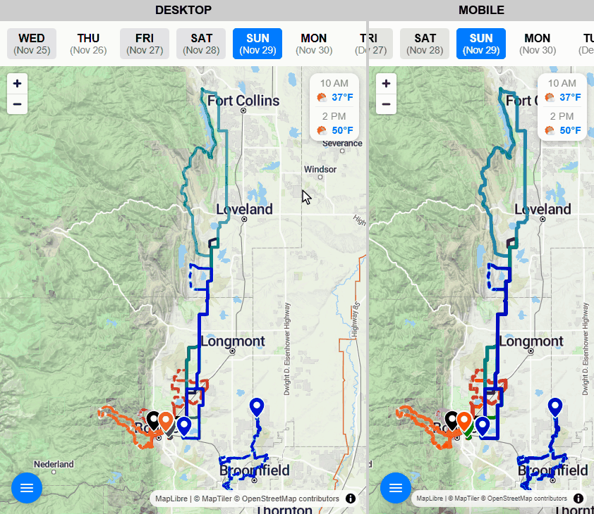

<!-- If you use Visual Studio Code, you can render the README.md locally: Ctrl+Shift+V -->
[](https://buymeacoffee.com/rbergua)
<a href="https://github.com/rbergua/boulderrides/commits/data">
  
</a>

# Boulder Group Rides

An interactive map showing **cycling group rides in Boulder, Colorado**.
It aggregates **Strava and Ride with GPS club events** and displays upcoming rides by day, with the **weather forecast** for each day and a **detailed, along-the-route forecast** for some individual rides. It also lists nearby **races and events** sourced from **BikeReg**.



## Live version
The frontend is a static website hosted on GitHub Pages, served directly from the repository.

- **Primary site:** https://boulderrides.cc
- **GitHub Pages:** https://rbergua.github.io/boulderrides/

## Features

- **7-day calendar** — Quickly see which days have scheduled rides; the first day with rides loads automatically
- **Interactive map** — Routes are drawn as color-coded polylines using [MapLibre GL JS](https://maplibre.org/) with MapTiler vector tiles and an automatic fallback to Stadia Maps. Women-only rides use purple color
- **Daily weather** — A small box on the map shows the forecast for two times of the selected day
- **Detailed weather** — The ride card shows a **Weather** button (when available) that opens a full-screen forecast along the ride's route
- **Metric/Imperial units** — The "Metric" button in the bottom-left ☰ menu switches between miles/feet ↔ km/meters and °F ↔ °C (imperial by default)
- **Paved vs unpaved surfaces** — Routes are drawn as solid lines on paved surfaces and dashed lines on unpaved surfaces
- **Desktop** — Hover over a route or its start pin to highlight it and dim the others to gray, showing a tooltip with the club name, ride title, start time, distance, elevation gain, and whether the ride is women-only; click to open the ride card with a link to the Strava, Ride with GPS event, or site
- **Mobile** — Tap a route or its start pin to see the same ride card as a bottom sheet; swipe the sheet down (or tap the map background) to dismiss it and restore all routes
- **Races & Events** — Dedicated page listing upcoming races and events
- **GPX Downloads** — Dedicated page listing upcoming rides with a one-tap GPX download per ride, sortable by distance or elevation gain

## Getting Started

### Prerequisites

No build tools required — this is a plain HTML/JS app. You just need a local HTTP server.

### Run Locally

```bash
# Using Python
python -m http.server 8000
```

Then open [http://localhost:8000](http://localhost:8000) in your browser.

> **Tip:** Hard refresh (`Ctrl+Shift+R` on Windows/Linux, `Cmd+Shift+R` on Mac) forces the browser to re-download all files instead of using cached versions.

> **Tip:** To emulate a mobile device, open browser DevTools (`F12`) and toggle the device toolbar.

## Project Structure

```
main branch
├── index.html                  # Main app (map + calendar)
├── gpx/index.html              # GPX download page (list of rides with downloadable GPX files)
├── detailed_weather/index.html # Detailed weather page (charts and wind map along a ride's route)

data branch
├── club_rides.json         # Ride data (latitude, longitude, altitude, surface), auto-updated by the backend process (Strava and Ride With GPS API)
├── races.json              # Race and event data, auto-updated by the backend process (BikeReg API). Major events not on BikeReg are hardcoded
├── weather.json            # Daily weather data, auto-updated by the backend process (National Weather Service API)
└── detailed_weather.json   # Per-ride forecast along the route, auto-updated by the backend process (National Weather Service API)
```

## Ride Data Format

Ride data is automatically fetched from the Strava and Ride with GPS API by a backend process that runs twice a day (12 PM & 1 AM) and keeps `club_rides.json` in the `data` branch up to date.

> [!NOTE]
> On June 1, 2026, Strava announced significant changes to its Developer Program and API Terms:
>
> * An active Strava subscription is required to maintain API access.
>
> Meanwhile, Ride with GPS has introduced support for free non-recurring ride events in addition to its paid Club Account offering that includes recurring rides, expanding the options available for group ride organization.

Each entry in the array represents one ride:

```json
[
  {
    "source": "Strava",
    "club_id": 575042,
    "club_name": "Rapha Boulder",
    "title": "Gravel to Fritz",
    "date": "2026-03-08 10:00",
    "url": "https://example.com/ride",
    "starting_location": [40.01528,-105.24836],
    "women_only": false,
    "route_id": 3524962925431313104,
    "dist_mi": 41.7,
    "elev_gain_ft": 1749,
    "route": [
      [40.01478,-105.24793,1603,1],
      [40.01478,-105.24770,1603,1],
      [40.01475,-105.24750,1603,1],
      [40.01478,-105.24697,1603,1],
      ...
    ]
  }
]
```

| Field | Type | Description |
|---|---|---|
| `source` | string | Data source: `"Strava"`, `"Ride with GPS"`, or `"Site"` |
| `club_id` | number | Strava or Ride with GPS club ID; `null` if unavailable |
| `club_name` | string | Name of the organizing club |
| `title` | string | Ride name |
| `date` | string | `"YYYY-MM-DD HH:MM"` in 24-hour format; displayed as 12-hour (AM/PM) in the frontend |
| `url` | string | Link to the Strava or Ride with GPS ride event |
| `starting_location` | `[lat, lng]` | Start marker position (optional; if not available, it uses the first point in `route`) |
| `women_only` | boolean | If `true`, indicates the event is women-only. Since Ride with GPS does not support this flag, the value defaults to `false`. |
| `route_id` | number | Strava or Ride with GPS route ID |
| `dist_mi` | number | Route distance in miles (1 decimal); `null` if unavailable |
| `elev_gain_ft` | number | Total elevation gain in feet (integer); `null` if unavailable |
| `route` | `[[lat, lng, altitude, surface], ...]` | Array of latitude and longitude coordinates defining the route; each point includes the altitude in meters (integer) for use in the GPX `<ele>` element, and a surface tag (`0`: unpaved, `1`: paved, or `null` if the OpenStreetMap surface classification failed |

## Race and Events Data Format

Race and event data is stored in `races.json` in the `data` branch. Data is refreshed weekly from the BikeReg API (Mondays at 3 AM). Some major events not listed on BikeReg (e.g., Triple Bypass, Mt. Blue Sky Hill Climb, Buffalo Bicycle Classic, Tuesday Night Thunder) are hardcoded in the backend. Each entry in the array represents one race or event:

```json
[
  {
    "name": "Koppenberg Road Race",
    "url": "http://www.withoutlimits.co",
    "reg_link": "http://www.BikeReg.com/73713",
    "location": "Superior",
    "latitude": 39.9527634,
    "longitude": -105.1685977,
    "type": ["Road Race", "American Cycling Association"],
    "date": "2026-05-03"
  },
  {
    "name": "Superville Stage Race",
    "url": "http://www.withoutlimits.co",
    "reg_link": "http://www.BikeReg.com/74224",
    "location": "Superior",
    "latitude": 39.9083424,
    "longitude": -105.1699298,
    "type": ["Road Race"],
    "date": ["2026-05-16", "2026-05-17"]
  }
]
```

| Field | Type | Description |
|---|---|---|
| `name` | string | Display name of the race or event |
| `url` | string | Event website URL |
| `reg_link` | string | Registration link (typically a BikeReg URL) |
| `location` | string | City or town where the event takes place |
| `latitude` | number | Latitude of the event location |
| `longitude` | number | Longitude of the event location |
| `type` | array of strings | One or more event type tags (e.g. `"Road Race"`, `"Criterium"`, `"Time Trial"`, `"Mountain Bike"`, `"Special Event"`) and/or sanctioning body (e.g. `"American Cycling Association"`, `"Colorado Bicycle Racing Association (CBRA)"`) |
| `date` | string or array of strings | Event date in `YYYY-MM-DD` format; use a plain string for single-day events, or an array of strings for multi-day events (e.g. a stage race) |

## Weather Data Format

Weather data is stored in `weather.json` in the `data` branch. Data is fetched daily from the National Weather Service at 5 AM and 11 AM and corresponds to downtown Boulder. Each entry in the array represents one day:

```json
{
  "2026-06-30": [
    {
      "time": "9 AM",
      "temperature_F": 70,
      "description": "Sunny",
      "symbol": "☀️"
    },
    {
      "time": "4 PM",
      "temperature_F": 87,
      "description": "Slight Chance Showers And Thunderstorms",
      "symbol": "🌩️"
    }
  ]
}
```

| Field | Type | Description |
|---|---|---|
| (key) | string | Forecast date in `YYYY-MM-DD` format |
| `time` | string | Forecast time, (Daylight Savings Time (summer): `"9 AM"` and `"4 PM"`, Standard Time (winter): `"10 AM"` and `"2 PM"`) |
| `temperature_F` | number | Temperature in degrees Fahrenheit (converted to Celsius in the frontend when Metric is selected) |
| `description` | string | Short text description of conditions (e.g. `"Sunny"`, `"Mostly Sunny"`, `"Chance Showers And Thunderstorms"`) |
| `symbol` | string | Emoji representing the forecast (e.g. `"☀️"`, `"🌤️"`, `"🌩️"`) |

## Detailed Weather Data Format

Detailed weather data is stored in `detailed_weather.json` in the `data` branch. It contains a forecast for an upcoming ride, estimated at several points along its route (one every 20 minutes of riding, assuming an average speed), so the forecast reflects the conditions along the route. Weather comes from the National Weather Service. The file has the following structure:

```json
{
  "sample_interval_minutes": 20,
  "ride_count": 19,
  "rides": [
    {
      "club_name": "Wednesday Flag",
      "ride_title": "Wednesday Flag",
      "date": "2026-11-25 12:00",
      "dist_miles": 12.6,
      "average_speed_mph": 8.4,
      "status": "available",
      "sunrise": "2026-11-25T06:57:57-07:00",
      "sunset": "2026-11-25T16:38:05-07:00",
      "samples": [
        {
          "timestamp": "2026-11-25T12:00:00-07:00",
          "dist_miles": 0.0,
          "lat": 40.02567,
          "lon": -105.28131,
          "temp_F": 46,
          "feels_like_F": 44,
          "wind_speed_mph": 5.0,
          "wind_dir": "ESE",
          "wind_gust_mph": 8.1,
          "rain_chance": 0,
          "symbol": "🌤️",
          "description": "Mostly Sunny"
        },
        ...
      ]
    },
    {
      "club_name": "The Super Cyclist",
      "ride_title": "wednesday morning winter roll",
      "date": "2026-11-25 08:00",
      "dist_miles": 32.4,
      "average_speed_mph": null,
      "status": "not available",
      "samples": []
    }
  ]
}
```

| Field | Type | Description |
|---|---|---|
| `sample_interval_minutes` | number | Time between consecutive forecast samples along a ride |
| `ride_count` | number | Number of entries in `rides` |
| `rides` | array | One entry per upcoming ride |

Each entry in `rides`:

| Field | Type | Description |
|---|---|---|
| `club_name` | string | Name of the club (same as in `club_rides.json`) |
| `ride_title` | string | Ride name (same as in `club_rides.json`) |
| `date` | string | `"YYYY-MM-DD HH:MM"` in 24-hour format (same as in `club_rides.json`). Together with `ride_title`, it identifies the ride, which is how the frontend matches a ride to its forecast |
| `dist_miles` | number | Route distance in miles |
| `average_speed_mph` | number or `null` | Average speed used to estimate when the rider reaches each point of the route, stops included; `null` when there is no forecast |
| `status` | string | `"available"` if the ride has a forecast, or `"not available"` otherwise. The Weather button in the ride card is only shown for `"available"` rides |
| `sunrise` | string | Sunrise time as an ISO 8601 timestamp with its UTC offset. Only present for `"available"` rides. Drawn as a vertical line in the charts when it falls within the ride |
| `sunset` | string | Sunset time, same format as `sunrise` |
| `samples` | array | Forecast samples along the route, in order from the start to the finish; empty when `status` is `"not available"` |

Each entry in `samples`:

| Field | Type | Description |
|---|---|---|
| `timestamp` | string | Estimated time at which the rider reaches this point, as an ISO 8601 timestamp with its UTC offset. The first sample is the ride's start time |
| `dist_miles` | number | Distance from the start of the route in miles |
| `lat` | number | Latitude of the point on the route |
| `lon` | number | Longitude of the point on the route |
| `temp_F` | number | Temperature in degrees Fahrenheit (converted to Celsius in the frontend when Metric is selected) |
| `feels_like_F` | number | "Feels like" temperature in degrees Fahrenheit (also converted when Metric is selected) |
| `wind_speed_mph` | number | Wind speed in miles per hour (converted to km/h when Metric is selected) |
| `wind_dir` | string | Compass direction the wind blows **from**, as an abbreviation (e.g. `"E"`, `"ESE"`, `"WNW"`) |
| `wind_gust_mph` | number | Wind gust speed in miles per hour (converted to km/h when Metric is selected) |
| `rain_chance` | number | Chance of precipitation (rain or snow) as a percentage (0-100) |
| `symbol` | string | Emoji representing the forecast (e.g. `"☀️"`, `"🌤️"`, `"🌩️"`) |
| `description` | string | Short text description of conditions (e.g. `"Mostly Sunny"`) |

## Customization

- **Days shown** — Change the `7` in `generateCalendar()` to show more or fewer days. Note that a longer window of time could be misleading. Recurring weekly rides on Strava only appear once their previous occurrence has passed, so looking further ahead would result in missing entries
- **Default map center** — Update `DEFAULT_CENTER` in `index.html` (currently set to downtown Boulder)
- **Default zoom** — Update `DEFAULT_ZOOM` (currently `12`)
- **Route colors** — Edit the `colors` (and `womenColors`, for women-only rides) palette arrays in `index.html` to change the cycle of colors assigned to routes
- **Weather** — Set `ENABLE_WEATHER` (daily weather box) or `ENABLE_DETAILED_WEATHER` (Weather button in the ride card) to `false` in `index.html` to turn them off
- **Map tiles** — The app loads MapTiler (outdoor/terrain) as the primary tile source. If MapTiler fails (e.g., quota exceeded or not available), it silently falls back to Stadia Maps. The MapTiler API key is locked to requests from `boulderrides.cc`


## Built With

- [MapLibre GL JS](https://maplibre.org/) — Interactive maps with vector tile rendering
- [Chart.js](https://www.chartjs.org/) — Temperature, wind, and precipitation charts on the detailed weather page
- [MapTiler](https://www.maptiler.com/) — Outdoor/terrain map tiles (primary)
- [Stadia Maps](https://stadiamaps.com/) — Outdoor/terrain vector map tiles (fallback if MapTiler is not available). Free, no API key required
- [Service Worker](https://developer.mozilla.org/en-US/docs/Web/API/Service_Worker_API) — Extends MapTiler tile cache from the default 8 hours to 120 days, saving API requests and making the map load faster for returning visitors (tiles served from disk instead of the network)
- [OpenStreetMap](https://www.openstreetmap.org/) — Road surface data source used for paved/unpaved classification, queried via the [Overpass API](https://overpass-api.de/) by the backend
- [Strava API](https://developers.strava.com/) — Source of group ride data, fetched by the backend
- [Ride with GPS API](https://ridewithgps.com/api) — Source of group ride data, fetched by the backend
- [BikeReg API](https://www.bikereg.com/) — Source of race and event data, fetched by the backend
- [National Weather Service API](https://www.weather.gov/documentation/services-web-api) — Daily and per-ride (detailed) weather forecasts, fetched by the backend
- [GoatCounter](https://www.goatcounter.com/) — Privacy-friendly analytics (unique visitors)
- [Cloudflare Web Analytics](https://www.cloudflare.com/web-analytics/) — Privacy-friendly analytics; page loads and load times

## Support

If you find this project useful, you can also buy me a coffee (donate a small amount) with the link below:

[](https://buymeacoffee.com/rbergua)